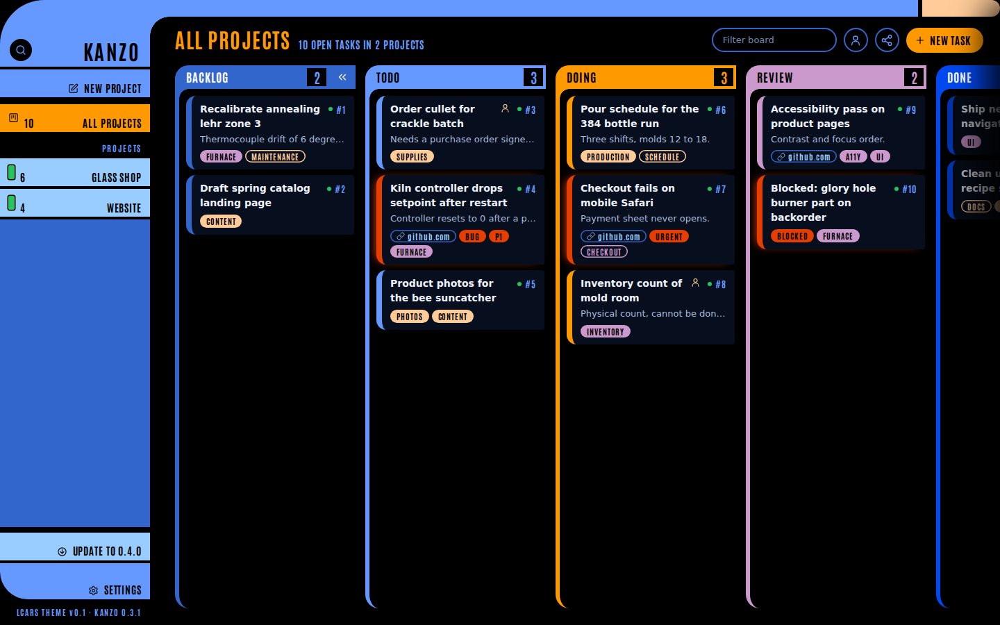
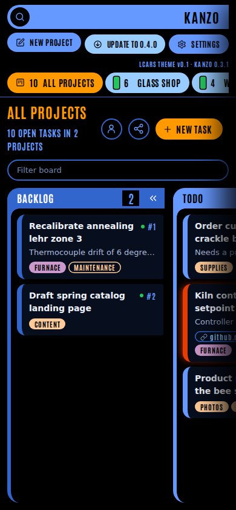
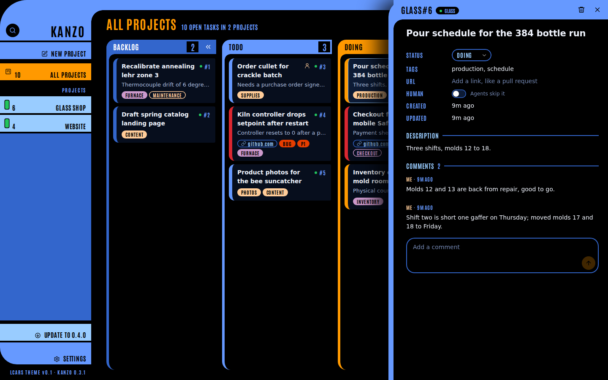
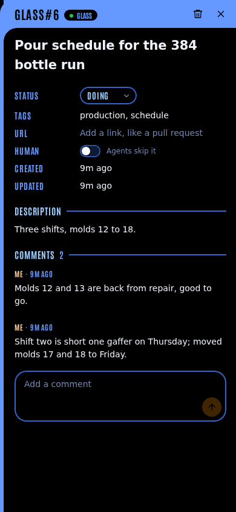

# LCARS theme for Kanzo

A Star Trek TNG style computer display for the board: an elbow frame, a left column of bars, column header bars with numeric readouts, and dark capped cards. Pure CSS (`src/lcars.css`, about 20 KB) plus the self-hosted Antonio Bold font (`src/fonts/antonio.woff2`, SIL OFL 1.1, license in `src/fonts/OFL.txt`). The default Kanzo look is untouched: every rule sits under `html[data-theme="lcars"]`, and the stylesheet only loads when the theme is on.

| Desktop, 1440 x 900 | Phone, 390 x 844 |
| --- | --- |
|  |  |
|  |  |

## Turn it on

In `~/kanzo/config.toml`:

```toml
theme = "lcars"   # or "kanzo", the default
```

Restart Kanzo. Any other value is refused at startup. To compare looks without changing the file, open `/?theme=lcars` or `/?theme=kanzo`; it lasts for that visit only.

With the theme on, the server builds a second copy of the page once at startup: `<html lang="en" data-theme="lcars">`, a `<meta name="kanzo-version">` tag and `<link rel="stylesheet" href="/lcars.css">` before `</head>`, and the footer line `LCARS THEME v0.1 · KANZO <version>` at the bottom of the sidebar. New routes: `/lcars.css` and `/fonts/antonio.woff2`. The CSP gains `font-src 'self'`.

## Colors

| Token | Hex | Used for |
| --- | --- | --- |
| `--lcars-cool-blue` | #6699FF | Frame: elbow, top bar, New project, Settings, the todo column, panel and dialog title bars |
| `--lcars-anakiwa` | #99CCFF | Project bars in the sidebar, focus rings, links |
| `--lcars-mariner` | #3366CC | Lines: rest of the left column, input and dialog borders, the backlog column |
| `--lcars-midnight` | #0048F0 | The done column (done cards are also dimmed) |
| `--lcars-neon-carrot` | #FF9900 | Active work: the doing column, New task, the selected project, the page title |
| `--lcars-atomic-tangerine` | #FF6633 | Reserved for active work (not used in v0.1) |
| `--lcars-lilac` | #CC99CC | Tags (hue 0 solid, hue 2 outlined), the review column, the update bar |
| `--lcars-honey` | #FFCC99 | Tags (hue 1 solid, hue 3 outlined), top bar end cap, human-task mark, toasts |
| `--lcars-pumpkin` | #E63D00 | Alerts only: alert tag chips, the cap's pulse |
| `--lcars-cardinal` | #DA2537 | Alerts only: the alert card's cap, delete hover |

Tag hue: each tag chip carries `data-tag-hue` 0 to 3, a stable hash of the tag name, so a tag keeps its color everywhere.

## Alert rule

A card is an alert when one of its tags is exactly `blocked`, `urgent`, `p0`, `p1` or `bug` (Kanzo stores tags lowercase). Its left cap turns Cardinal and pulses toward Pumpkin every 2.4 s; the matching tag chip turns Pumpkin. With `prefers-reduced-motion: reduce` the pulse stops and the cap stays Cardinal. Nothing else uses the alert colors.

## Agent DOM contract

These attributes are on the page in both themes, so an agent driving a browser can read the board without guessing at classes. Kanzo's own ids and classes are unchanged.

| Element | Attributes |
| --- | --- |
| Column | `data-agent="kanban-column"` `data-column-id="<status>"` |
| Column count | `data-agent="column-count"` (text is the count; empty means 0) |
| Card | `data-agent="task-card"` `data-task-id` `data-status` `data-project="<slug>"` `data-tags="a,b"` and `data-human="true"` when flagged |
| Tag chip | `data-tag="<name>"` `data-tag-hue="0-3"` |
| Sidebar project | `data-agent="project"` `data-project-id="<slug>"` (`all` for All projects) |
| Task panel | `data-agent="task-panel"`, plus `data-task-id` while a task is open |

Example: `document.querySelectorAll('[data-agent="task-card"][data-status="doing"]')` lists the cards in progress.

## Iterate

1. Edit `src/lcars.css`. For fast looks, intercept `/lcars.css` in Playwright and serve the local file, so no rebuild is needed until the end.
2. Bump the version in three places together: line 1 of `src/lcars.css` (`/* LCARS theme vX.Y */`), `--lcars-theme-version` in the same file, and `LCARS_VERSION` in `src/web.rs`. The test `lcars_page_injects_theme_stylesheet_and_version` fails if they disagree.
3. `cargo build --release`, run a board with `theme = "lcars"`, and shoot 1440 x 900 and 390 x 844 of the board and an open task. Save them here as `lcars-vX.Y-desktop.png`, `-mobile.png`, `-desktop-panel.png`, `-mobile-panel.png`, and update the links above.

---

Version: v0.1 · created 2026-11-07 · updated 2026-11-07
Changes: v0.1 first cut of the LCARS theme docs.
This file: /home/claude/dev/kanzo/.claude/worktrees/lcars/docs/lcars/README.md (branch lcars-theme)
