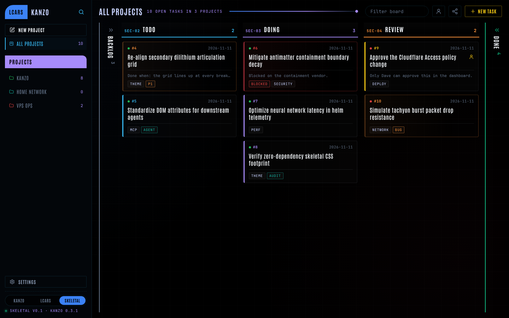
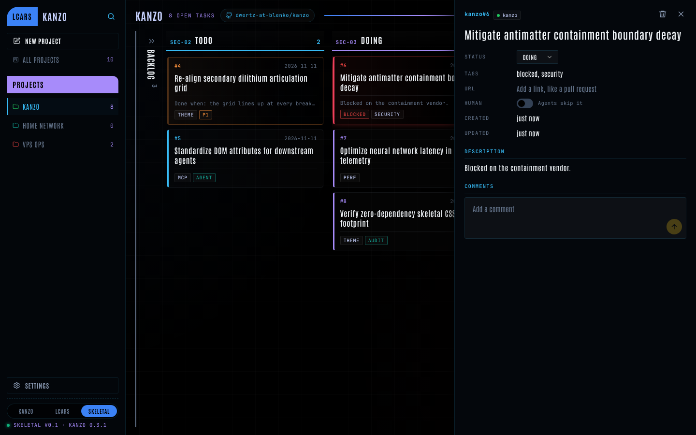
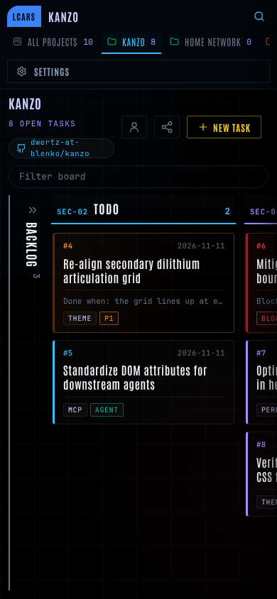
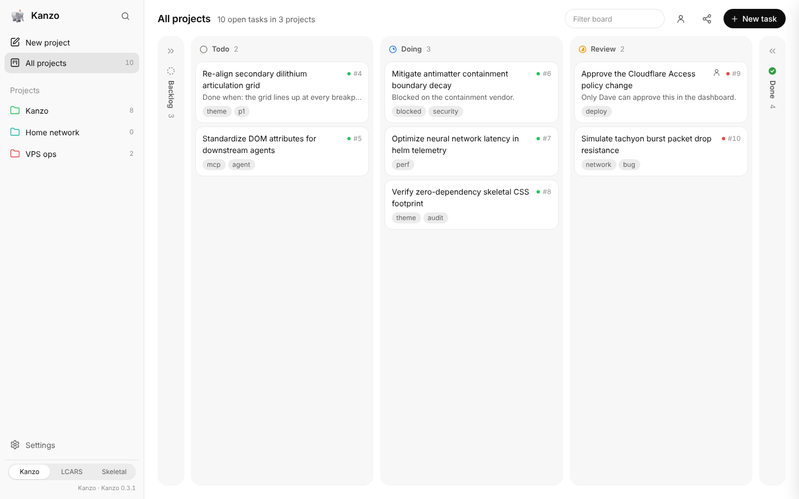

# Themes

Kanzo has three looks. They are one attribute apart: every theme's CSS sits under `html[data-theme="<name>"]`, all stylesheets are in the page, and switching changes the attribute. No reload, no flash.

| Theme | Name | Where it comes from | Version |
| --- | --- | --- | --- |
| Kanzo | `kanzo` | Upstream Kanzo, light and dark with the system | follows Kanzo |
| LCARS | `lcars` | `src/lcars.css`, the classic Starfleet palette in Antonio Bold (built on the VPS, branch `public-url`) | 0.2 there; a stub here until that branch is merged |
| Skeletal LCARS | `skeletal` | `src/skeletal.css`, the dark hairline terminal designed in Google Stitch ([original](skeletal/stitch-code.html), [render](skeletal/stitch-screen.png)) | 0.1 |

## Picking one, and making it stick

- **The switcher** at the bottom of the sidebar (`#theme-tabs`, `data-agent="theme-switcher"`), or **Settings, Board, Theme**.
- The pick is a board setting (`PATCH /api/settings {"theme": "skeletal"}`, kept in the database). Every browser that opens the board gets it, on the first paint, because the server writes it into `<html data-theme>`. Open boards follow within the next poll.
- `theme = "..."` in `config.toml` is only the starting point for a board that has never picked.
- `/?theme=lcars` previews a look for one visit, without changing the board; the version line says `preview`. Clicking the switcher ends the preview and saves.
- The version line under the switcher reads `<Theme> v<version> · Kanzo <version>`. Agents can read `<meta name="kanzo-themes">` and `<meta name="kanzo-version">`.

| Skeletal, desktop | Skeletal, a task open |
| --- | --- |
|  |  |

| Skeletal, phone | Stock look with the switcher |
| --- | --- |
|  |  |

## What a theme can rely on

The board's DOM carries attributes for themes and agents alike; themes style them, agents read them.

| Element | Attributes |
| --- | --- |
| `.column` | `data-status`, `data-agent="kanban-column"`, `data-column-id`; its `h2 .count` has `data-agent="column-count"` |
| `.card` | `data-id`, `data-task-id`, `data-agent="task-card"`, `data-status`, `data-project`, `data-tags` (space separated), `data-human="true"` when human, `data-alert="red"` (tags blocked, urgent, p0) or `"amber"` (p1, bug), `data-updated` (date), `data-comments` |
| `.card .num` | `data-updated`, for themes that show the date in the card's meta row |
| `.tag` | `data-tag` |
| `.nav .item` | `data-agent="project"`, `data-project-id` |
| `#theme-bar` | `data-agent="theme-switcher"`; each `.theme-tab` has `data-theme-pick` and `aria-pressed` |
| `<html>` | `data-theme`, `data-theme-preview` while previewing, `data-hide` (hidden properties) |

## Adding or changing a theme

1. Put every rule under `html[data-theme="<name>"]` in `src/<name>.css`, first line `/* <Name> theme v<version> */`, and set `--theme-version: "<version>"` in its root block.
2. In `src/home.rs` add the variant to `Theme`, `Theme::ALL` and `Theme::NAMES`; in `src/web.rs` add the `include_str!`, the route, the version constant and the `<meta name="kanzo-themes">` entry; in `src/theme.js` and `app.js` (`THEMES`) add the name; link the stylesheet in `src/index.html`.
3. Bump the version with every visible change, in the stylesheet's two places and in `web.rs`: `cargo test` fails when they disagree.
4. Fonts and scripts come from this server only (CSP `font-src 'self'`, `script-src 'self'`); add a route for anything new, and keep it small: the whole program is about 5 MB.
5. Screenshot desktop, the task panel and a phone, and put them in `docs/themes/<name>/`.

For the Skeletal design system itself (tokens, type, components, the alert hierarchy), see the skill in `.claude/skills/skeletal-lcars/`.

## Merging the VPS fork's LCARS theme

The LCARS theme was built on the VPS in `/home/claude/dev/kanzo`, branch `public-url`, and never pushed. When that branch is merged here:

- take theirs for `src/lcars.css` (v0.2), then set `LCARS_VERSION` in `src/web.rs` to `"0.2"`;
- `src/fonts/antonio.woff2` here is the variable font (weights 100 to 700), which covers the Bold the LCARS theme asks for: keep this one;
- take this branch's `src/theme.js`, the theme parts of `src/web.rs`, `src/app.js` and `src/index.html` (the three-way switcher replaces the v0.2 footer toggle; the saved pick moves from the browser's localStorage to the board);
- keep theirs for the `url` setting (`src/home.rs`, `Guard` in `src/web.rs`), `deploy/` and `docs/lcars/`;
- `cargo test`, then check `/?theme=lcars` shows the LCARS look and the version line reads `LCARS v0.2`.
